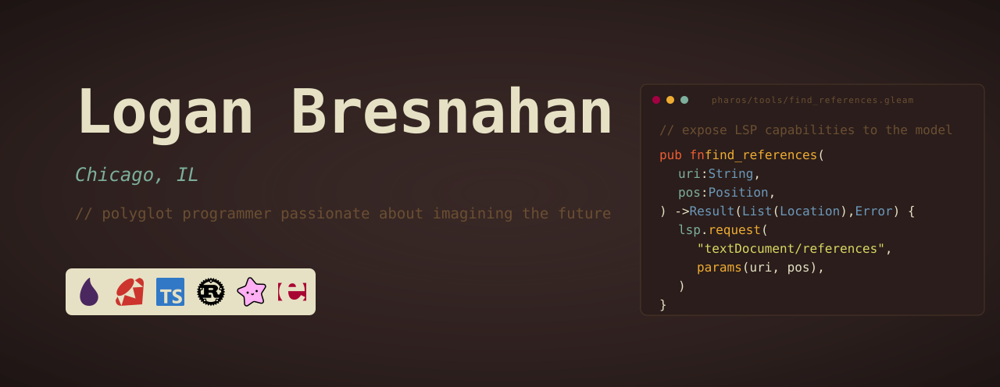

---

## Projects

### [pharos-mcp](https://github.com/LoganBresnahan/pharos-mcp) · Gleam, Elixir, Erlang

An MCP server that exposes Language Server Protocol (LSP) capabilities. Utilizes the BEAM (Erlang Virtual Machine) to supervise multiple LSP servers for a polyglot environment. Distributed as a single self-contained binary via [Burrito](https://github.com/burrito-elixir/burrito), shipped through [GitHub Releases](https://github.com/LoganBresnahan/pharos-mcp/releases) and [npm](https://www.npmjs.com/package/pharos-mcp).

### [DeepSeek-Moby](https://github.com/LoganBresnahan/DeepSeek-Moby) · TypeScript, VS Code

A fully agentic AI coding assistant for VS Code, inspired by and built for DeepSeek. Streams native tool calls; shell-command approval system with allow/blocklists; conversation forking; Tavily and SearXNG-backed web search, and so much more. OpenAI-compatible BYOM. [VS Code Marketplace](https://marketplace.visualstudio.com/items?itemName=LoganBresnahan.deepseek-moby).

### [geex](https://github.com/LoganBresnahan/geex) · Elixir, Rust

An LLM-native terminal text editor on the BEAM. Human keystrokes, agent edits over MCP, extensions, and remote peers all become the same command value, run through one dispatcher into one undo history — each tagged with who made it. Undo, deterministic replay, and provenance fall out of that single path instead of AI being bolted on as a parallel plugin. geex owns the world; the agent is bring-your-own. Tree-sitter highlighting through a Rust NIF ([tree_sitter_wasm](https://github.com/LoganBresnahan/tree_sitter_wasm)) that loads grammar `.wasm` at runtime, with grammars and themes installed from a sha256-pinned catalog. Self-updating Linux and macOS releases via [GitHub Releases](https://github.com/LoganBresnahan/geex/releases).

### [captAInHook](https://github.com/LoganBresnahan/captAInHook) · C#, F#

A framework that injects deterministic or AI-powered subsystems into an agent's loop at fixed lifecycle seams — guaranteed execution at prompt submission, tool invocation, and result processing, instead of hoping the model calls a tool. A long-lived daemon with F# actor supervision, Native-AOT shims talking over a Unix socket, and a browser GUI. Released for Linux and macOS via [GitHub Releases](https://github.com/LoganBresnahan/captAInHook/releases) and dogfooded live on my own agent sessions.

### [j_r_r_token](https://github.com/LoganBresnahan/j_r_r_token) · Ruby + Rust

Ruby bindings for [tiktoken-rs](https://github.com/zurawiki/tiktoken-rs) — *Just Ruby, Rust, & Tokens*. Ships pre-compiled native extensions, so end users skip the Rust toolchain. Published to [RubyGems](https://rubygems.org/gems/j_r_r_token).

### [birds-of-paradise-zed](https://github.com/LoganBresnahan/birds-of-paradise-zed) · Zed

The only theme I will use. A warm, brown-based, light-on-dark theme for the Zed Editor — the latest link in a chain that started with Joe Bergantine's original Coda theme. [Published on the Zed extension registry](https://zed.dev/extensions/birds-of-paradise-theme).

---

## Open source contributions

- **[gleam-lang/gleam#5702](https://github.com/gleam-lang/gleam/pull/5702)** — fixed `gleam publish` writing the wrong OTP application name into hex metadata when the hex package name differed from the OTP app name. Matched the pattern rebar3 uses for transitive-dep resolution. *Merged.*
- **[JuliusBrussee/cavemem#16](https://github.com/JuliusBrussee/cavemem/pull/16)** — diagnosed and fixed `cavemem mcp` exiting silently: the CLI dispatched via dynamic import while the server bootstrap was guarded behind an `isMainEntry()` check that returns false for non-entrypoint loads. *Merged.*
- **[zed-industries/extensions#6151](https://github.com/zed-industries/extensions/pull/6151)** — added Birds of Paradise to the official Zed extension registry. *Merged.*
- **[synrc/fs#68](https://github.com/synrc/fs/pull/68)** — fixed a spurious "macOS 10.7 or later required" error caused by relying on the deprecated Gestalt Manager when run on macOS 11+. *Merged.*

---

Working in: **Elixir · Ruby · TypeScript · Rust · Gleam · Erlang**

Reach me: [loganbbres@gmail.com](mailto:loganbbres@gmail.com)
